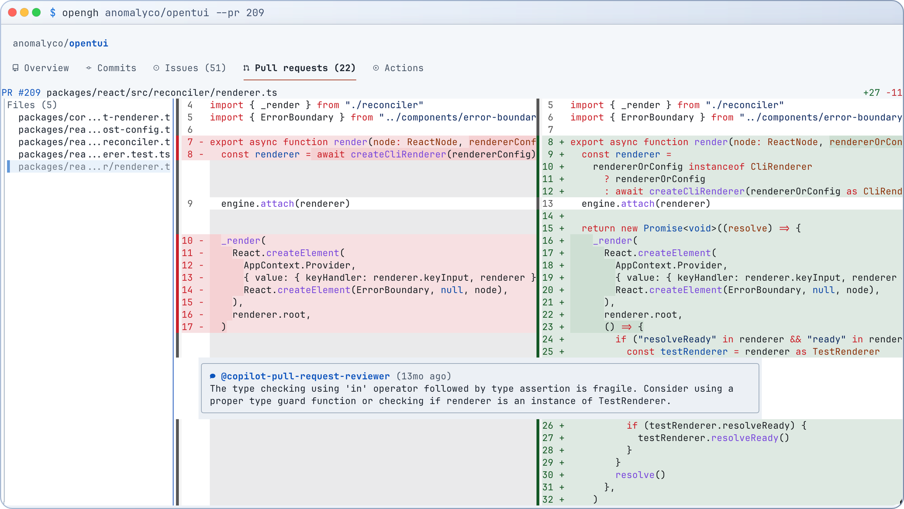
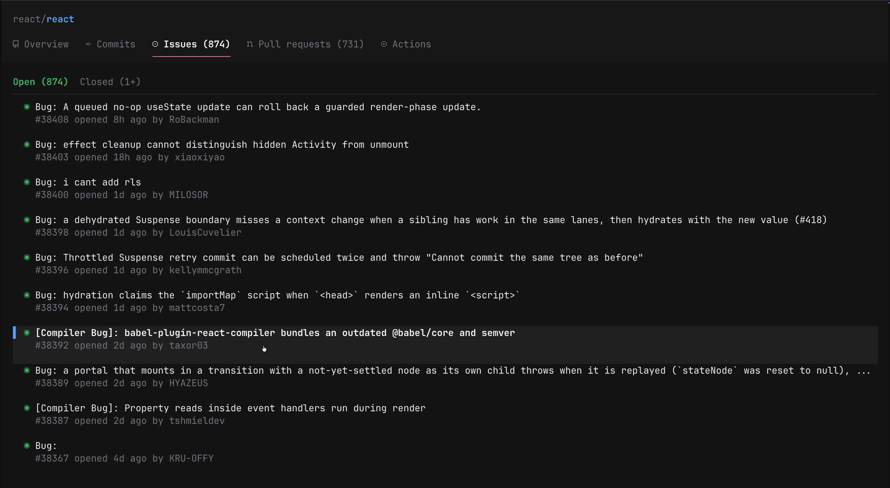

<p align="center">
  <picture>
    <source media="(prefers-color-scheme: dark)" srcset="docs/assets/logo-dark-jetbrains.png" />
    
  </picture>
</p>

<p align="center">
  <a href="https://github.com/leohenon/opengh/releases"></a>&nbsp;
  <a href="https://github.com/leohenon/opengh/actions/workflows/ci.yml"></a>
</p>

<p align="center">Run <code>opengh</code> in your repo, or pass it a GitHub link, and you're there. You'll already know your way around.</p>

<picture>
  <source media="(prefers-reduced-motion: reduce) and (prefers-color-scheme: dark)" srcset="docs/assets/screenshot-dark.png" />
  <source media="(prefers-reduced-motion: reduce)" srcset="docs/assets/screenshot-light.png" />
  <source media="(prefers-color-scheme: dark)" srcset="docs/assets/screenshot-dark-animated.svg" type="image/svg+xml" />
  <source media="(prefers-color-scheme: light)" srcset="docs/assets/screenshot-light-animated.svg" type="image/svg+xml" />
  
</picture>

> **Public beta:** Commands and config may change before v1.0. Please [report bugs](https://github.com/leohenon/opengh/issues).

## Install · [Guide](docs/installation.md)

Available for macOS and Linux. The only requirement is a signed-in [GitHub CLI](docs/installation.md#authenticate).

```sh
# Curl
curl -fsSL https://github.com/leohenon/opengh/releases/latest/download/install.sh | sh

# Homebrew
brew install leohenon/tap/opengh

# npm
npm install --global @leohenon/opengh

# Nix
nix profile install github:leohenon/opengh#opengh nixpkgs#gh
```

## Get started · [Usage](docs/usage.md)

```sh
opengh .                                          # Current directory's repository
opengh owner/repo                                 # Any repository
opengh owner/repo --pr 123                        # Open a specific pull request
opengh https://github.com/owner/repo/pull/123     # A GitHub link
```

Press `?` for shortcuts, or right-click anything.

## Update

```sh
opengh update
```

## For agents · [Agent CLI](docs/agent-cli.md)

Gives your agent a whole PR in one command, including the line comments `gh pr view` leaves out.

```sh
npx skills add leohenon/opengh --skill opengh --global
```

## Demo · [Demos](docs/demos.md)



## Documentation

[Installation](docs/installation.md) · [Usage](docs/usage.md) · [CLI](docs/cli.md) · [Keybindings](docs/keybindings.md) · [Configuration](docs/configuration.md) · [Agent CLI](docs/agent-cli.md) · [Development](docs/development.md) · [Roadmap](ROADMAP.md)

---

<p align="center">
  <sub>
    <a href="https://github.com/leohenon/opengh/blob/main/LICENSE">MIT licensed</a> · Built with
    <a href="https://bun.sh/">Bun</a>,
    <a href="https://github.com/anomalyco/opentui">OpenTUI</a>,
    <a href="https://www.solidjs.com/">SolidJS</a>, and
    <a href="https://github.com/modem-dev/hunk">Hunk</a>.
  </sub>
</p>
