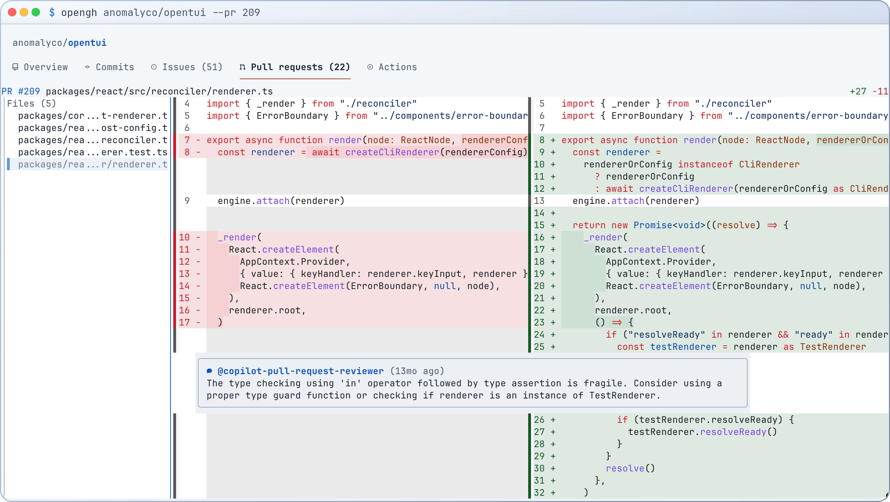

<p align="center">
  <picture>
    <source media="(prefers-color-scheme: dark)" srcset="docs/assets/logo-dark-jetbrains.png" />
    
  </picture>
</p>

<p align="center">A familiar terminal interface for GitHub.</p>

<picture>
  <source media="(prefers-reduced-motion: reduce) and (prefers-color-scheme: dark)" srcset="docs/assets/screenshot-dark.png" />
  <source media="(prefers-reduced-motion: reduce)" srcset="docs/assets/screenshot-light.png" />
  <source media="(prefers-color-scheme: dark)" srcset="docs/assets/screenshot-dark-animated.svg" type="image/svg+xml" />
  <source media="(prefers-color-scheme: light)" srcset="docs/assets/screenshot-light-animated.svg" type="image/svg+xml" />
  
</picture>

- **Manage** repositories, issues, pull requests, and Actions.
- **Review** diffs, leave inline comments, and submit reviews.
- **Navigate** with your keyboard or mouse.

## Install

Available for macOS and Linux. Uses [GitHub CLI authentication](https://cli.github.com/manual/gh_auth).

```sh
# Homebrew
brew install leohenon/tap/opengh

# npm
npm install --global opengh

# Curl
curl -fsSL https://github.com/leohenon/opengh/releases/latest/download/install.sh | sh

# Nix
nix profile install github:leohenon/opengh#opengh nixpkgs#gh
```

## Open a repository

```sh
opengh .               # Current directory's repository
opengh owner/repo      # Any repository
```

> [!TIP]
> Press `?` for shortcuts, `,` for settings, or right-click for actions.

## Update

```sh
opengh update
```

## Documentation

[Configuration](https://github.com/leohenon/opengh/blob/main/docs/configuration.md) · [Keybindings](https://github.com/leohenon/opengh/blob/main/docs/keybindings.md) · [CLI](https://github.com/leohenon/opengh/blob/main/docs/cli.md) · [Development](https://github.com/leohenon/opengh/blob/main/docs/development.md)

See the [roadmap](https://github.com/leohenon/opengh/blob/main/ROADMAP.md) for what's planned.

---

<p align="center">
  <sub>
    <a href="https://github.com/leohenon/opengh/blob/main/LICENSE">MIT licensed</a> · Built with
    <a href="https://bun.sh/">Bun</a>,
    <a href="https://github.com/anomalyco/opentui">OpenTUI</a>,
    <a href="https://www.solidjs.com/">SolidJS</a>, and
    <a href="https://github.com/modem-dev/hunk">Hunk</a>.
  </sub>
</p>
