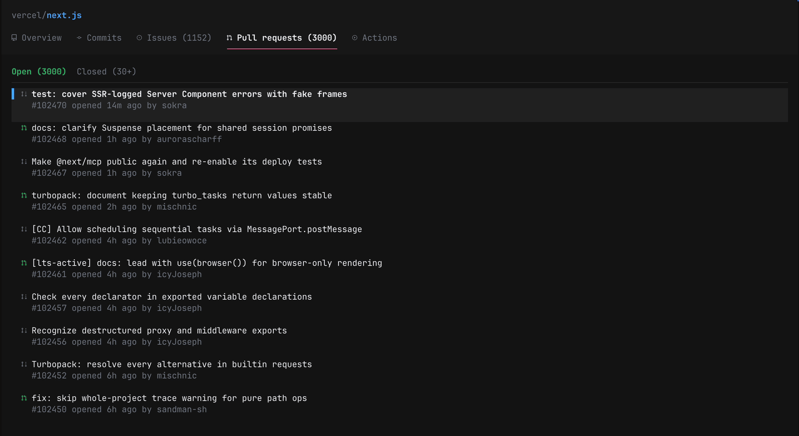
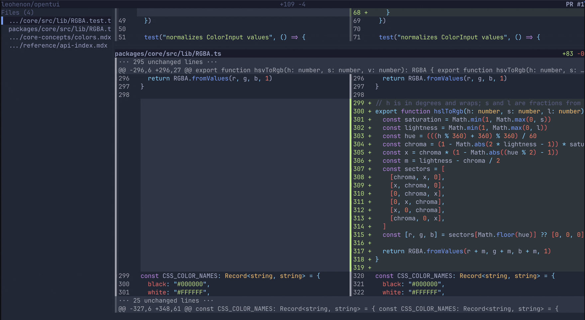
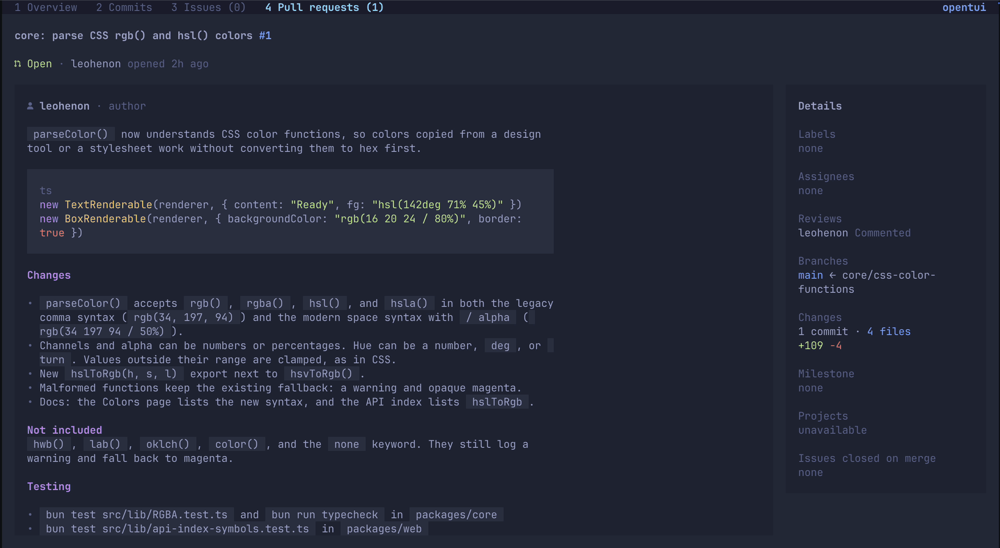
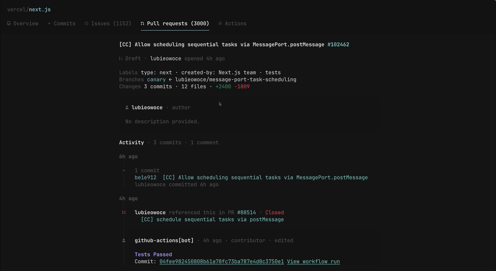
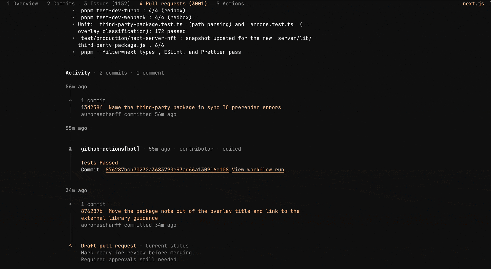
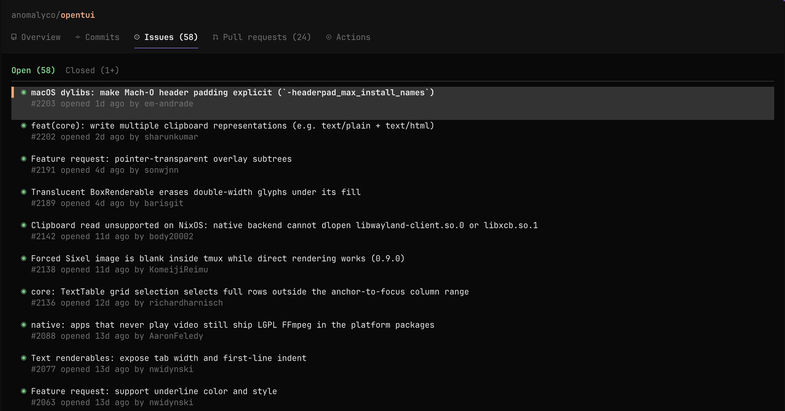
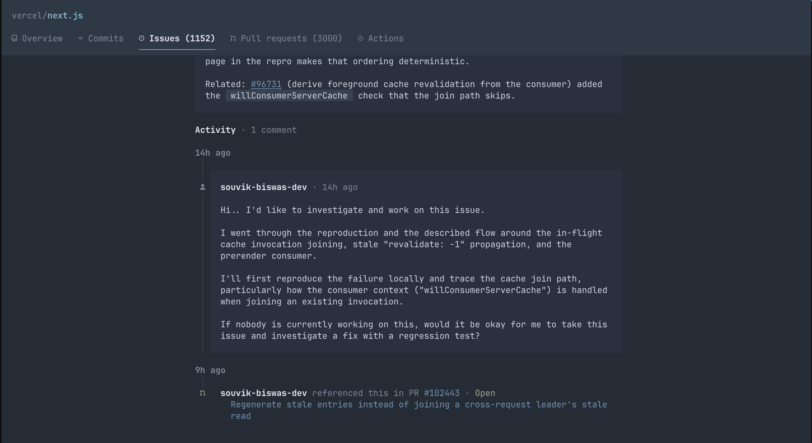
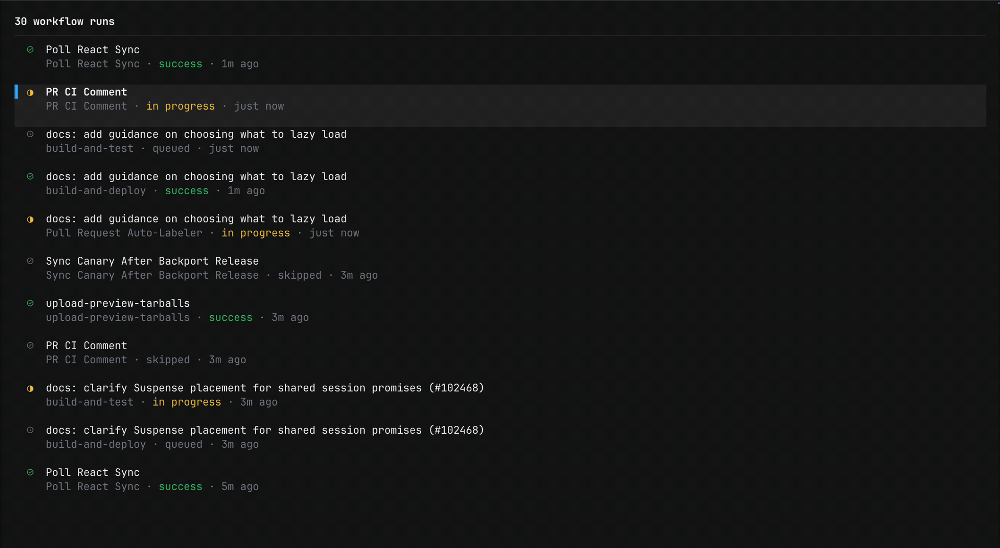

# Demos

## Filter and search

## Review a pull request

## Merge or close a pull request

## Click your way around

## Or use the keyboard

## Jump between repositories

## Mention people

## Inspect GitHub Actions runs

